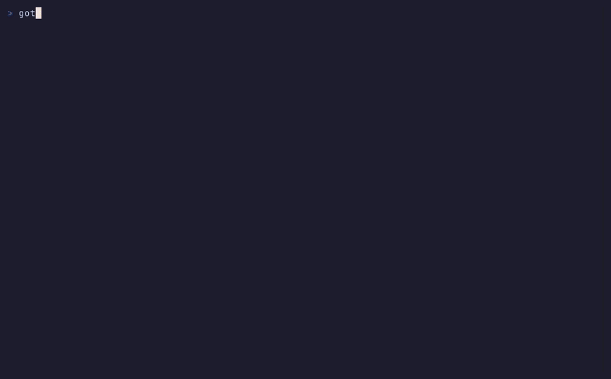
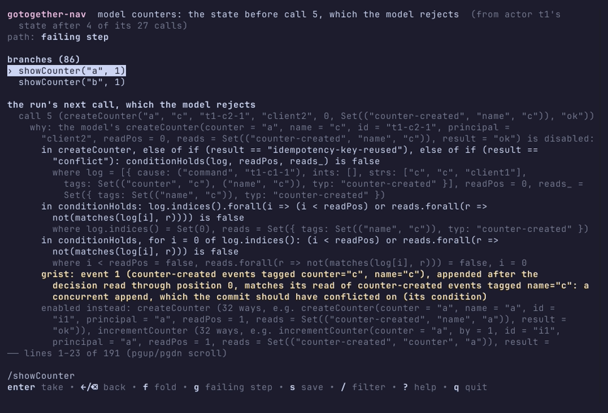
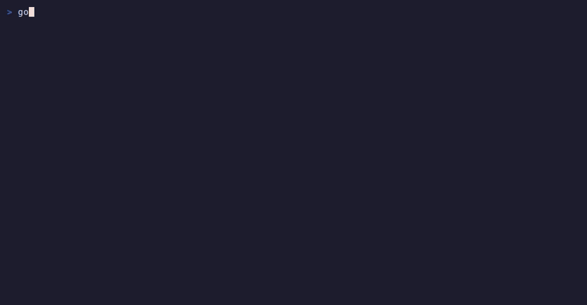
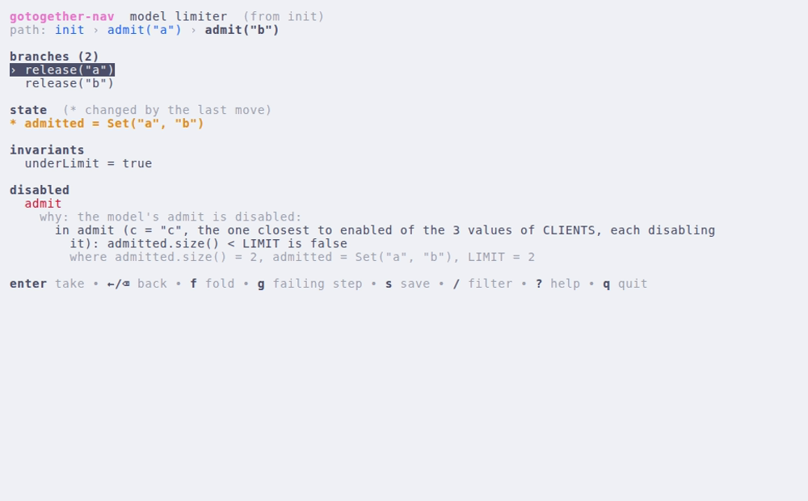

# qnav: gotogether-nav, the interactive navigator

`gotogether-nav` walks a Quint model's states, or an exploration's run by
its choices, in the terminal (DESIGN §58, ROADMAP P5). It is the people's
front end; agents use `gotogether nav ... -json`, which reads the same
nodes. It is a module of its own so that Charm's libraries (bubbletea,
lipgloss, bubbles) stay out of the core.

```sh
go install github.com/chucklehead-dev/gotogether/qnav/cmd/gotogether-nav@latest
```

`gotogether nav` without `-json` opens it on a terminal when it is on
PATH (and says how to install it otherwise; `-text` prints the node as
text). It takes the same arguments:

```sh
gotogether-nav -binding limiter.yaml                                   # a model, from init
gotogether-nav -binding b.yaml -run steps.jsonl [-actor a] [-at k]     # a recorded run's state after k calls (a run the model rejects opens at its failing step)
gotogether-nav -run 'TestX#2:seed=17' [-pkg DIR] [-at fail|start|<schedule>@<k>]   # an exploration's run (a failing report's navigate: line)
```

A run is navigated through a session of its test's binary
(`GOTOGETHER_NAV=serve`): compiled once (`go test -c`), then each node is
a replay of the run with its choices forced, a few hundred milliseconds
with its verdict, rather than a `go test` process (seconds). A mutant's
run is its mutant binary's: `GOTOGETHER_MUTANT=<name>`, as the run's
navigate line sets it, has the binary built with the overlay of
`testdata/mutants/<name>` (`qtest.Mutants`), over the files of
`GOTOGETHER_MUTANT_PACKAGE`'s directory when the line sets it (a harness
package's mutants of another package, payd's).


## Keys

| key | does |
|---|---|
| ↑/↓ (k/j) | move among the branches |
| enter (→, l) | take the branch: a model's transition, a run's option |
| ⌫ (←, h) | back to the node before |
| f | fold the linear stretch: a model's single branches until a node of several; a run's choices that are no decision (nominal where the base run's are) to the run's next decision |
| g | the failing step: a run's last choice before its failing step (`fail`); a recorded run's state before the call the model rejects |
| s | save the run node's run to the exploration's corpus (`ExploreConfig.Corpus` or `GOTOGETHER_CORPUS`) |
| / | filter the branches (enter keeps it, esc clears it) |
| pgdn/pgup | scroll the node's detail |
| ? | all the keys |
| q | quit |

## What a node shows

A model's node: the path from the start (crumbs), its branches (the
step's transitions: the action's call with its arguments), the state
with the variables its last move changed marked `*`, the invariants, the
recorded call the model rejects with why (a run opened at its failing
step), and the disabled actions, each with its first false condition and,
for a grist app, grist's reading of it.

```
gotogether-nav  model limiter  (from init)
path: init › admit("a") › admit("b")

branches (2)
› release("a")
  release("b")

state  (* changed by the last move)
* admitted = Set("a", "b")

invariants
  underLimit = true

disabled
  admit
    why: the model's admit is disabled:
      in admit (c = "c", the one closest to enabled of the 3 values of CLIENTS, each disabling
        it): admitted.size() < LIMIT is false
        where admitted.size() = 2, admitted = Set("a", "b"), LIMIT = 2

enter take • ←/⌫ back • f fold • g failing step • s save • / filter • ? help • q quit
```

A run's node: the verdict of the run it makes (nominal after it), the
next choice's options (`◂ the run took` marks the base run's), the steps
recorded so far, each actor's model state (changes from the node before
marked `*`; a step the model rejects, with why), the simulation's tasks.

```
gotogether-nav  TestMutant#1:seed=1  node 0:1,1:1,2:2,4:1,5:2@6
path: fail › 2 counter.handle
verdict rejects apply  (the run this node makes, nominal after it; after 6 choices, at 0s)

next choice: sched.task (3 options)
  0 counter.main  → 0:1,1:1,2:2,4:1,5:2@7
  1 counter.handle  → 0:1,1:1,2:2,4:1,5:2,6:1@7
› 2 counter.handle  → 0:1,1:1,2:2,4:1,5:2,6:2@7  ◂ the run took

steps so far (2)
  apply(id=1)
  apply(id=1)

model (default)
  the model rejects a step so far:
  call 2 (apply(1))
    why: the model's apply(id = 1) is disabled:
      in apply: not(applied.contains(id)) is false
        where applied = Set(1), id = 1
      enabled instead: replay(id = 1), apply(id = 2), apply(id = 3)

tasks
  client: waiting until 100ms
  counter.handle: runnable
  counter.handle: runnable
  counter.main: runnable
```

Colors are the terminal's sixteen, so a light or a dark theme chooses
their shades; with `NO_COLOR` set there are none, and the markers (`›`
the cursor, `*` a change, `◂` the run's option) say what they did.

## Scenarios

The tapes in [tapes/](tapes) are [VHS](https://github.com/charmbracelet/vhs)
scripts: each drives the binary in a real terminal, renders a GIF and a
screenshot for these docs, and, as text, is checked by `go test ./tapes/`
against its golden (`tapes/testdata/*.golden.txt`).

| tape | shows |
|---|---|
| [limiter.tape](tapes/limiter.tape) | a model: take `admit("a")`, `admit("b")`, read why `admit` is disabled at the limit, go back |
| [hello.tape](tapes/hello.tape) | a failing run (hello's noDedupe mutant, its binary built with the mutant's overlay: `GOTOGETHER_MUTANT=noDedupe`) at `fail`: the steps, the model's state and the verdict, the run's option (the duplicate rejected, with why), another branch, saved to a corpus |
| [grist.tape](tapes/grist.tape) | counters' blind mutant's run at its failing step: why, in grist's words (a concurrent append) |
| [fold.tape](tapes/fold.tape) | folding: the ticks model's five single ticks in one move |





The light theme: 

To run or render them you need `vhs`, `ttyd`, `ffmpeg` and `quint` on
PATH (none is a dependency of any module here):

```sh
go install github.com/charmbracelet/vhs@v0.12.1
sudo apt-get install -y ttyd ffmpeg        # or your system's packages (ttyd ≥ 1.7)
go test ./tapes/                           # the tapes as text, against their goldens (GOTOGETHER_UPDATE_GOLDEN=1 rewrites them)
tapes/render.sh                            # the GIFs and screenshots in tapes/media (TAPES=hello.tape for one)
```

vhs drives a headless Chromium (go-rod): it uses one on PATH (`chromium`,
`google-chrome`) or downloads its own; as root the browser's sandbox
refuses to start, which `VHS_NO_SANDBOX=true` lifts (the test and
render.sh set it for root).

## Tests

`go test ./...` drives the navigator's model (`internal/tui`) with key
messages and compares its screens with goldens, without a terminal: the
limiter (two admits, the change marked, admit's why, back), the filter,
folding the ticks model, `NO_COLOR`, a run node's change from its parent,
counters' blind mutant's rejection read as grist's, and hello's noDedupe
mutant's run through a session of its test binary built with the
mutant's overlay (skipped under `-short`).
Charm's teatest has no released v2, so the tests call Update directly.

Versions: bubbletea v2.1.0, lipgloss v2.0.6, bubbles v2.2.1
(`charm.land/...`, released at least two weeks before they were chosen).
